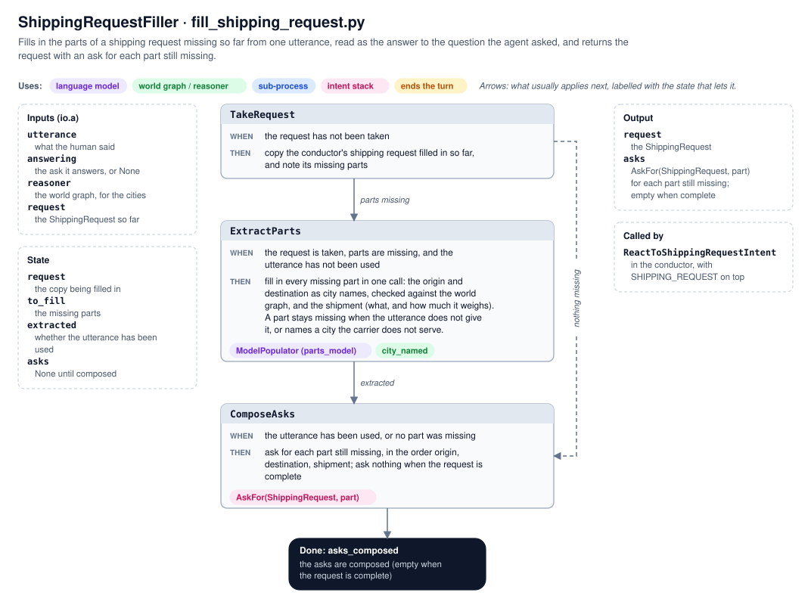

# Model filler

How the agent fills in a model, such as a shipping request, from what the human says, across as many turns as it
takes, and asks for what is still missing. Today the filler is specific to `ShippingRequest`
(`logistics_agent/fill_shipping_request.py`). The last section proposes how to make it generic, so it can fill in
entities and relations too.

## What it does

The human doesn't have to describe the whole delivery at once. When a part is missing, the agent asks for it. The
parts it already has are kept across turns, and the agent keeps asking until the request is complete:

```
you › 200 pounds of books
agent › Which city is the shipment picked up from?
you › Boston
agent › Which city is the shipment going to?
you › Denver
agent › Got it: the box of books (200 lb) from Boston to Denver. Ask me what it costs whenever you are ready.
```

## Questions come from the model

The agent never writes its own questions. They come from the model being filled in:

- for the whole model, its docstring
- for one attribute, the attribute's `Field` description

So `ShippingRequest`'s docstring and field descriptions are written as questions (`domain.py`):

| Ask | Question |
| --- | --- |
| `AskFor(ShippingRequest)` | What are you shipping, how much does it weigh, and which cities is it going from and to? |
| `AskFor(ShippingRequest, "origin")` | Which city is the shipment picked up from? |
| `AskFor(ShippingRequest, "destination")` | Which city is the shipment going to? |
| `AskFor(ShippingRequest, "shipment")` | What are you shipping, and how much does it weigh? |

The same descriptions are given to the language model when it fills in the parts, so they also tell it what each
part means.

## The sub-process: `ShippingRequestFiller`



### Inputs

The conductor restarts the sub-process for every utterance about a delivery. Its operators read these arguments
from `io.a`:

| Argument | What it is |
| --- | --- |
| `utterance` | What the human said. |
| `answering` | The `AskFor` the utterance answers, or `None`. Its question is given to the language model as context, so a short answer such as "Denver" is understood. |
| `reasoner` | The reasoner, whose world graph holds the cities the carrier serves. |
| `request` | The `ShippingRequest` filled in so far. Only its missing parts are extracted. |

### State and operators

```python
@dataclass
class ShippingRequestState:
    request: ShippingRequest | None = None     # a copy of the request taken from the conductor
    to_fill: list[str] = []                    # the parts missing from it
    extracted: bool = False                    # whether those parts have been extracted from the utterance
    asks: list[AskFor] | None = None           # the parts still missing afterwards; None until composed
```

| Operator | WHEN | THEN |
| --- | --- | --- |
| `TakeRequest` | the request has not been taken | copy the conductor's request, and note its missing parts as `to_fill` |
| `ExtractParts` | the request is taken, parts are missing, and they have not been extracted | fill in the missing parts together, in one call to the language model |
| `ComposeAsks` | the parts have been extracted, or none were missing | record an `AskFor` for each part still missing, in the order origin, destination, shipment |

**Termination:** the asks have been composed.

### Output

The final state. It always finishes, so it never returns `None` for a missing part:

- `asks == []`: the request is complete.
- `asks != []`: those parts are still missing. `request` keeps whatever was filled in, so "from Seattle" is not lost
  while the agent asks for the destination.

## Joint extraction

The missing parts are filled in **together, in one call** to the language model. `parts_model` builds a model of just
the missing parts, each optional, and `ExtractParts` populates it with a `ModelPopulator`:

```
Base Model: ShippingRequestParts (the parts of a delivery the human gives; each thing the human mentions fills in one part only)
* origin (str | None; Which city is the shipment picked up from? The name of a city, one of Detroit, Boston, Seattle, San Francisco, Denver; None when ...)
* shipment (ShipmentParts | None; What are you shipping, and how much does it weigh? None when ...)

Base Model: ShipmentParts (what is shipped and how much it weighs, each None when the utterance does not give it)
* details (str | None; what is shipped, such as 'pallet of office chairs')
* weight (float | None; weight of the shipment, in pounds)
```

**Why together:** an earlier version filled in each part with its own call. Asked "Which city is the shipment picked
up from?", the human said "Boston", and the call for the destination took "Boston" too. Each call saw the utterance on
its own, with nothing to say the city was already used. In one call, the parts compete for what the human said, so
each mention fills in one part only:

| Asked | Answer | Filled in |
| --- | --- | --- |
| Which city is the shipment picked up from? | "Boston" | origin |
| Which city is the shipment picked up from? | "Boston, and it is going to Denver" | origin and destination |

The question being answered is context, not a restriction. An answer that gives more than was asked fills in
everything it gives.

### Lenient types

One call means one validation, so a single bad part could lose all the others. The parts model is lenient so that it
doesn't:

- **A city is a plain name,** not an enum of the served cities. `city_named` checks it against the world graph's
  cities afterwards, by display name or name. A city the carrier doesn't serve, such as "Portland", leaves only that
  part missing.
- **The shipment's details and weight are optional.** A shipment without both is left missing, and the other parts
  are kept.
- **A failed call** (`UnexpectedModelBehavior` or `ValidationError`) leaves every part missing. The agent then asks
  for them.

What is kept is named by the filler, not the language model: the origin is `shipping-origin`, the destination
`shipping-destination`, and the shipment `shipment`.

## How the conductor uses it

The conductor keeps the request across turns in `ConversationState.shipping_request`, and asks for what is missing
with `AskFor` intents on its intent stack.

### Filling in: `ReactToShippingRequestIntent`

It applies with `SHIPPING_REQUEST` on top of the stack:

1. **Continue or start over.** It continues the request being asked for, if an `AskFor(ShippingRequest, …)` is on
   the stack. Otherwise it starts a new one.
2. **The ask being answered.** The agent ends a turn with a question only with its ask on top. So when the answer
   pushes `SHIPPING_REQUEST`, the ask right under it is the one answered (`ConversationState.answered_ask()`).
3. **Run the filler** with `suppress_errors=False`, so a real error raises instead of being hidden.
4. **Take the request,** pop `SHIPPING_REQUEST`, and push `AskFor(ShippingRequest)` with an ask for each missing part
   above it, the first on top. Pushing an ask that is already on the stack moves it to the top.

### Asking and popping

An ask pops when the model has what it asks for, not when the human answers:

| Top of the stack | Operator | Then |
| --- | --- | --- |
| `AskFor` (any), not satisfied | `AskQuestion` | say its question and end the turn; the ask stays |
| `AskFor(ShippingRequest, part)`, satisfied | `PopSatisfiedAsk` | pop it |
| `AskFor(ShippingRequest)`, request complete | `ConfirmShippingRequest` | say "Got it: …", and pop it |

So the answer that fills in the last missing part pops that part's ask. The whole-request ask under it is then
confirmed. An ask further down that an earlier answer satisfied pops silently when it reaches the top.

"Ask me what it costs whenever you are ready" is left out of the confirmation when `ESTIMATE_PRICE` is already on the
stack.

### Example: a price asked before the delivery

| The human says | Stack afterwards (top on the right) |
| --- | --- |
| "how much will it cost?" | `ESTIMATE_PRICE`, `AskFor(SR)` |
| "200 pounds of books from Seattle" | `ESTIMATE_PRICE`, `AskFor(SR)`, `AskFor(SR, "destination")` |
| "Denver" | the destination ask pops, the request is confirmed, the delivery is planned and priced: empty |

With an incomplete request, `ReactToEstimatePriceIntent` pushes `AskFor(ShippingRequest)` and an ask for each
missing part. `ESTIMATE_PRICE` waits under them until they pop, and then `PlanDelivery` and `DescribePlan` answer it.

## Known limitations

- **Changing a complete request.** A delivery described while the agent is not asking for one starts a new request.
  "Make it Boston instead" does not change the destination of the existing one.
- **Answers that fill in nothing** get the same question asked again, with no explanation. Reporting which parts were
  filled, and why a part was not (such as a city the carrier doesn't serve), would allow a better reply.
- **No consistency checks.** Nothing stops the origin and destination from being the same city. A validator on the
  request, run once it is complete, would catch that.

## Proposal: generic model filling in cognition

The filler is specific to `ShippingRequest` for now. The same design should fill in any model, including entities
and relations, so the parts that are not specific to shipping requests belong in `cognition`. `ModelPopulator` does
not need to change: it already takes any pydantic model, including one built at runtime with `create_model`, and
`basemodel_description` already describes nested models and enums to the language model. What is missing is the
layer above it:

1. **A partial model of any model.** Build a model of just the attributes still to fill in, from the model's fields:
   - every attribute optional, defaulting to `None`;
   - each attribute described by its `Field` description, which is also the question asked for it;
   - an attribute that refers to an entity becomes the name of one of the world graph's entities of that type,
     listed in its description and checked afterwards. This generalizes the served cities here, so a value can only
     be something the world graph knows;
   - a nested model becomes its own partial model, so a shipment without its weight keeps its details and asks for
     the weight.

   `parts_model` in `fill_shipping_request.py` is this, written out by hand for `ShippingRequest`.
2. **A `Partial[M]` record of what is known so far.** Entities and relations require every field, so a half-filled
   one cannot be an instance. A `Partial` holds the values known so far, says which attributes are `missing()`, and
   `build()`s the model once nothing is missing. Its validators run there, and an error located on one attribute
   clears that attribute so it is asked again.
3. **A generic filler sub-process.** The same operators as `ShippingRequestFiller` (take the partial, extract the
   missing attributes together, compose the asks), parameterized by the model. It returns the `Partial` and an
   `AskFor` for each attribute still missing.
4. **Marking how each attribute is filled.** Whether an entity attribute refers to an existing entity (the origin
   city) or describes a new one (the shipment), and which attributes are never asked (an entity's `name`), as
   metadata on the field, e.g. `Field(json_schema_extra={"fill": "new"})`.

`AskFor`, and the rule that an ask pops once it is satisfied, already work for any model. Only
`ConversationState.model_of`, which maps each model to where the conductor keeps it, is specific to the agent.
