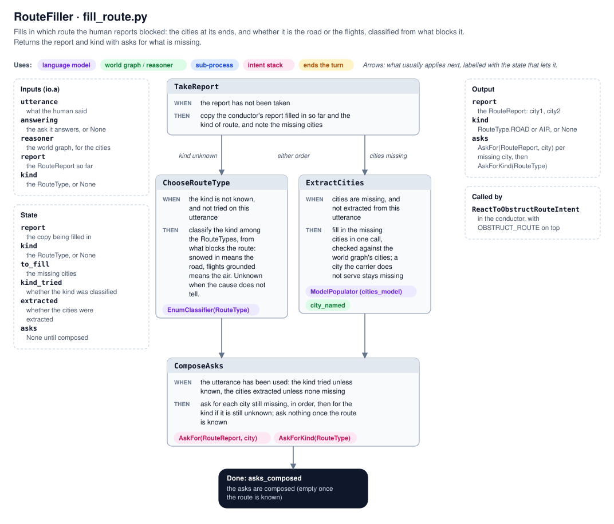

# Route closures

How the human reports a blocked route, such as a road snowed in, and the agent takes the route out of the world graph,
so deliveries are planned around it. It uses the same intent stack and asks as the shipping request
([model-filler.md](model-filler.md)), and the same confirmation as adding a vehicle
([fleet-updates.md](fleet-updates.md)). A closed route stays closed until the agent quits, because the world graph is
rebuilt every run.

```
you › the route between Seattle and San Francisco is snowed in
agent › Shall I close the road between Seattle and San Francisco?
you › yes
agent › Closed the road between Seattle and San Francisco; I will plan deliveries around it.
you › 800 pounds of office chairs from Seattle to San Francisco
agent › Got it: ... Ask me what it costs whenever you are ready.
you › how much?
agent › Delivering the office chairs from Seattle to San Francisco costs $845.00. ...
```

With the road open, that delivery is driven for $802. With it closed, the planner flies it instead.

## What is closed

Every pair of cities is connected twice: by a `TruckRoute` between the cities, driven by trucks, and by an `AirRoute`
between their airports. The human usually names the cities and what blocks the route, not which of the two it is. So
the agent works out the kind from the cause:

```python
class RouteType(DocEnum):
    """Is it the road or the flights between the two cities that are blocked?"""

    ROAD = ("road", "the road between two cities, driven by trucks: blocked by snow, ice, flooding, ...")
    AIR = ("air", "the flights between two cities' airports: blocked by grounded flights, a closed airport, ...")

    @property
    def model(self) -> type[TruckRoute | AirRoute]: ...
```

"Snowed in" or "a bridge out" means the road. "Flights grounded" means the air. When the cause doesn't tell, as in
"the route is blocked", the agent asks the enum's docstring through `AskForKind(RouteType)`. `AskForKind` takes the
enum it asks about, so the same ask serves the vehicle kind (`AskForKind(VehicleType)`).

The cities are filled into a `RouteReport`, whose docstring and field descriptions are the questions:

```python
class RouteReport(BaseModel):
    """Which route is blocked: between which two cities?"""
    city1: City | None = Field(default=None, description="Which city is at one end of the blocked route?")
    city2: City | None = Field(default=None, description="Which city is at the other end of the blocked route?")
```

Its fields are optional, so like `ShippingRequest` it is filled in directly, without a draft.

## `RouteFiller` (`fill_route.py`)



Inputs on `io.a`: `utterance`, `answering` (the ask the utterance answers), `reasoner`, `report` (the `RouteReport` so
far), and `kind` (the `RouteType`, or `None`).

| Operator | WHEN | THEN |
| --- | --- | --- |
| `TakeReport` | the report has not been taken | copy the conductor's report and kind, and note the missing cities |
| `ChooseRouteType` | the kind is not known, and not classified on this utterance | classify it with an `EnumClassifier` over `RouteType`, with the question asked as context |
| `ExtractCities` | cities are missing, not extracted yet | fill in the missing cities together, in one call; each is a plain name, checked against the world graph's cities (`city_named`), so a city the carrier does not serve leaves only that end missing |
| `ComposeAsks` | the utterance has been used | ask for each missing city in order, then for the kind if it is still not known |

## How the conductor uses it

The conductor keeps `route_report` and `route_type` in its state. `model_of(RouteReport)` is the report, and
`has(AskForKind(RouteType))` is whether the kind is known.

| Top of the stack | Operator | Then |
| --- | --- | --- |
| `OBSTRUCT_ROUTE` | `ReactToObstructRouteIntent` | run `RouteFiller`, continuing the route being asked for, or starting over when the agent is not asking about a route. Pop the intent, then push `AskFor(RouteReport)` with the asks for what is missing above it |
| `AskFor(RouteReport)`, both cities and the kind known | `ProposeClosure` | look up the route of that kind between the cities (`blocked_route`), in either direction since a route is declared once per pair; an air route is looked up between the cities' airports. If there is one, keep it as the pending change, a `RouteClosure`, and push `ConfirmChange`; if not, say there is nothing to close and drop the report |
| `ConfirmChange` | `AskToConfirmChange` | ask "Shall I close the road between …?" |
| `CONFIRM` | `ReactToConfirmIntent` | `RouteClosure` removes the route with `reasoner.remove_relation`, and says so |
| `DENY` | `ReactToDenyIntent` | say the route was left open |

The city and kind asks are asked by `AskQuestion` and popped by `PopSatisfiedAsk`, as for any ask.

### Removing a route

`Reasoner.remove_relation(relation_type, entity1, entity2)` removes the edge from the world graph. The relations the
world graph gives back are frozen copies, whose type is not the edge's key, so the type passed is the domain model,
`TruckRoute` or `AirRoute`, from `RouteType.model`. The ends are taken from the route as the world graph has it, so a
route declared from San Francisco to Seattle is removed from San Francisco to Seattle, whichever order the human named
the cities in.

The planner plans over the same world graph, so the next estimate no longer uses the route.

### Confirming changes

Adding a vehicle and closing a route share one confirmation. The conductor keeps one `pending_change`, either a
`VehicleAddition` or a `RouteClosure`. Each knows:

- its `question`: "Shall I close the road between Seattle and San Francisco?"
- how to `make` itself, returning what to tell the human
- what to say when `declined`
- what to `forget` afterwards: its report or drafts, and every ask for them still on the stack

`ConfirmChange` on the stack stands for the pending change. `AskToConfirmChange`, `ReactToConfirmIntent` and
`ReactToDenyIntent` work the same for both kinds of change.

## Known limitations

- **No reopening.** A closed route stays closed for the rest of the run; "the road is clear again" is not understood.
  Marking routes obstructed, instead of removing them, would allow it.
- **One pending change at a time.** Proposing a route closure while a vehicle addition waits for a yes or no replaces
  the pending change.
- **Only routes between two cities.** A whole city or airport cut off, such as "Denver airport is closed", is not
  understood as closing every route to it.
