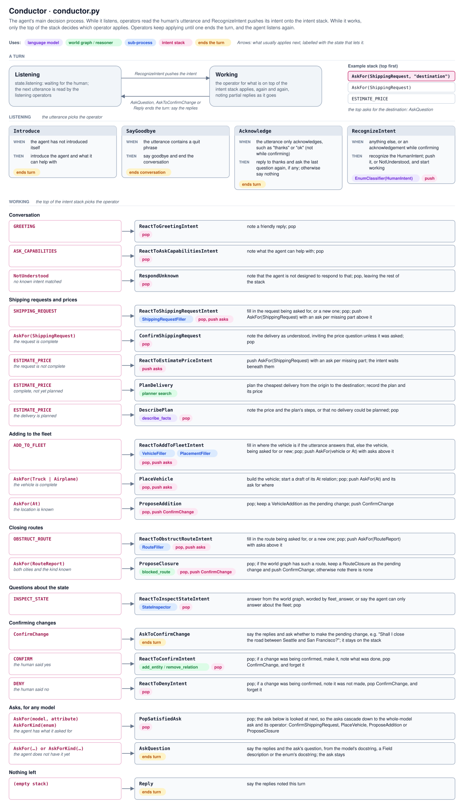

# Technical Approach

This demo is a conversational agent built with [`cognition`](https://github.com/polycog/cognition), a library for building neurosymbolic agents. It addresses the problem described in the [use case](usecase.md): quoting delivery prices for a small-fleet carrier, with every price worked out from the carrier's actual fleet, routes, and costs.

## Approach

The agent splits the work between two kinds of reasoning, so that each does what it does best:

- **Neural reasoning understands language.** An LLM turns what the human types into structured terms, through two `cognition` mechanisms:
  - an `EnumClassifier` recognizes the human's intent among a fixed set of `HumanIntent`s, such as describing a delivery, asking for a price, adding a vehicle, or reporting a blocked route;
  - a `ModelPopulator` fills in the parts of a model from the utterance: the shipment, its weight, and the cities it goes from and to, or a vehicle to add, or a route to close. Cities can only be ones the carrier serves.

  These terms are only proposals. The LLM never sets a price, never chooses a plan, and never decides what happens next.
- **Symbolic reasoning decides and plans.** Three symbolic mechanisms decide everything else:
  - the **conductor**, a decision process of WHEN/THEN operators, manages the conversation with a **stack of intents**: it decides what to ask for, when the request is complete, and when to plan;
  - the **world graph**, maintained by the reasoner, holds the carrier's cities, terminals, airports, vehicles, routes, gas price, and labor rates, and answers questions about them;
  - the **search planner** finds the cheapest sequence of drives, flights, loads, and unloads that gets the shipment where it is going. Each action is a `WorldEvolver` whose WHEN says when it applies and whose THEN says how it changes the world and what it costs.

  The price is the cost of the plan, and each step is described from its action's template. No LLM takes part in these steps, so the same request always gets the same plan and price, and every step can be traced.

## Example

The human asks for a price before describing the delivery, then leaves out the destination.

> *"How much will it cost?"*

1. **Neural.** The `EnumClassifier` recognizes `ESTIMATE_PRICE`, and the conductor pushes it onto the stack.
2. **Symbolic.** `ReactToEstimatePriceIntent` sees that there is no shipping request yet, so it pushes `AskFor(ShippingRequest)` above the price question. `AskQuestion` asks the request's own question: *"What are you shipping, how much does it weigh, and which cities is it going from and to?"*

> *"200 pounds of books from Seattle"*

3. **Neural.** The intent is `SHIPPING_REQUEST`. The `ModelPopulator` fills in all the missing parts in one call: the shipment is *books*, 200 lb, and the origin is Seattle. It finds no destination.
4. **Symbolic.** `ReactToShippingRequestIntent` keeps the parts it was given and pushes an ask for the one still missing, `AskFor(ShippingRequest, "destination")`. `AskQuestion` asks: *"Which city is the shipment going to?"*

> *"Denver"*

5. **Neural.** Reading the answer to that ask, the `ModelPopulator` fills in the destination: Denver.
6. **Symbolic.** The request is now complete, so the asks pop: `PopSatisfiedAsk` pops the ask for the destination, and `ConfirmShippingRequest` pops the ask for the whole request. `ESTIMATE_PRICE` is on top again, and `PlanDelivery` hands the delivery to the search planner, which works through the world graph:
   - Big Bertha, a truck at Seattle Terminal, drives to the shipment in Seattle: $50.00;
   - the books are loaded at Seattle labor rates, 200 lb × $0.60: $120.00;
   - Big Bertha drives the 1,300 miles to Denver at $0.80 per mile: $1,040.00;
   - the books are unloaded at Denver labor rates, 200 lb × $0.50: $100.00.

   `DescribePlan` replies: *"Delivering the books from Seattle to Denver costs $1,310.00."*, followed by the four steps, and pops `ESTIMATE_PRICE`, leaving the stack empty.

The stack after each turn (top on the right):

| The human says | Stack afterwards |
| --- | --- |
| "How much will it cost?" | `ESTIMATE_PRICE`, `AskFor(ShippingRequest)` |
| "200 pounds of books from Seattle" | `ESTIMATE_PRICE`, `AskFor(ShippingRequest)`, `AskFor(ShippingRequest, "destination")` |
| "Denver" | empty |

Flying would need a vehicle in Denver to carry the books from the airport, and there is none, so the planner drives. Had the human closed the road between Seattle and Denver, the planner would have found a way around it, or said that there is none. Had the LLM misread the weight, the confirmation *"Got it: the books (200 lb) from Seattle to Denver."* would show it before any price is given.

## Decision process

There is no scripted flow. Every turn, the conductor recognizes the human's intent and pushes it onto the stack. Recognizing only pushes: every other operator applies to what is on top of the stack, so the top alone decides what happens next. The stack holds two kinds of intents, both in `communicator.py`:

- `HumanIntent`, what the human wants, such as a price estimate. It is popped once it is done.
- `AgentIntent`, what the agent wants. `NotUnderstood` is pushed when the utterance matches no known intent, so the
  agent says it cannot respond to that. `AskFor` is another: an ask for a model being filled in, or for one attribute of
  it. Its question comes from the model itself: the docstring for the whole model, or the attribute's `Field`
  description. An ask is popped once the model has what it asks for, not when the human answers. So answering the
  last missing attribute pops that attribute's ask, and then the ask for the whole model under it.

Every operator of the conductor, and what is on top of the stack when it applies:



Adding a vehicle to the fleet uses the same stack: the agent fills in the vehicle, then where it is, then asks the
human to confirm before it changes the world graph. Reporting a blocked route works the same way, and closes the route
once the human confirms. Questions about the state of the world are answered from the world graph.

## The world

Five cities — Seattle, San Francisco, Boston, Denver, and Detroit — each with one terminal and one airport.

- **Trucks** drive between locations in the same city, or between locations in two cities that a truck route
  connects, as long as both cities have a terminal. Long-distance drives cost the gas price per mile of the route.
- **Airplanes** fly between airports along air routes, each with its own price.
- **Shipments** move only by being loaded into a vehicle. Loading and unloading cost the shipment's weight times the
  labor rate in that city.

At the start, Big Bertha (a truck) is at Seattle Terminal, Little Rocket (a truck) is at San Francisco Terminal, and
The Pelican (an airplane) is at Seattle-Tacoma airport. There are no shipments at the start, and a shipment is wherever
you say it is.

## Code layout

```
logistics_agent/   the agent
tests/             offline tests
docs/              the use case, this approach, and detailed designs of parts of the agent
llm_config.toml    which language model to use
pyproject.toml     dependencies and the logistics-agent command
LICENSE, NOTICE    the Apache License 2.0, and the copyright notice
CITATION.cff       how to cite this repository
```

| Module | Role |
| --- | --- |
| `assistant.py` | Runs the agent: reads lines from the terminal, prints replies, and loops until the human quits. |
| `conductor.py` | The decision process: the conversation state and one operator per thing the agent can do. |
| `console.py` | How the conversation looks in the terminal, drawn with Rich: the replies and the thin lines between them, the prompt, the spinner, and the reasoning steps. |
| `trace.py` | Reports, for `--trace`, which operator each decision process applies, when the planner searches, and where a language model is used. |
| `fill_shipping_request.py` | The sub-process that fills in a shipping request from what the human says: the cities it goes from and to, which can only be cities the carrier serves, and the shipment. It extracts every missing part in one call to the language model, and returns the request and an ask for each part still missing. |
| `communicator.py` | Language understanding: the human's intents, the agent's asks, and the LLM configuration. |
| `reasoner.py` | Builds and maintains the world graph, and answers queries and updates against it. |
| `planner.py` | The search planner: what each action does to the world, and the search for the cheapest plan. |
| `fill_vehicle.py` | The sub-process that fills in a vehicle to add to the fleet: its kind, classified among the `VehicleType`s, then its fields, all at once. |
| `fill_placement.py` | The sub-process that fills in where a vehicle being added is: an `At` relation to an existing terminal or airport (only airports for an airplane). |
| `fill_route.py` | The sub-process that fills in which route the human reports blocked: the cities at its ends, and whether it is the road or the flights, classified from what blocks it. |
| `inspect_state.py` | The sub-process that answers questions about the state of the world, such as which vehicles the fleet has: the language model classifies the question and fills in what it is about, and the reasoner looks the facts up. |
| `drafts.py` | Drafts of models whose fields are all required, such as a truck, filled in over several turns and built once nothing is missing. |
| `domain.py` | The domain model: cities, locations (terminals and airports, each in a city), vehicles (all tagged `FLEET`, and the `VehicleType`s the human can add), shipments, routes, costs, actions, and the shipping request (a shipment, the location it is sent from, and the location it goes to). The docstrings and field descriptions of what the agent fills in are the questions it asks for them. |

## Details

The detailed designs are in [`design/`](design), one doc per part of the agent:

- [Model filler](design/model-filler.md): the sub-process that fills in the shipping request, how the conductor asks for missing parts and pops the asks, why the parts are extracted together, the known limitations, and a proposal for making the filler generic in `cognition`
- [Fleet updates](design/fleet-updates.md): adding a vehicle to the fleet
- [Route closures](design/route-closures.md): closing a blocked route
- [State inspection](design/state-inspection.md): answering questions about the fleet from the world graph
